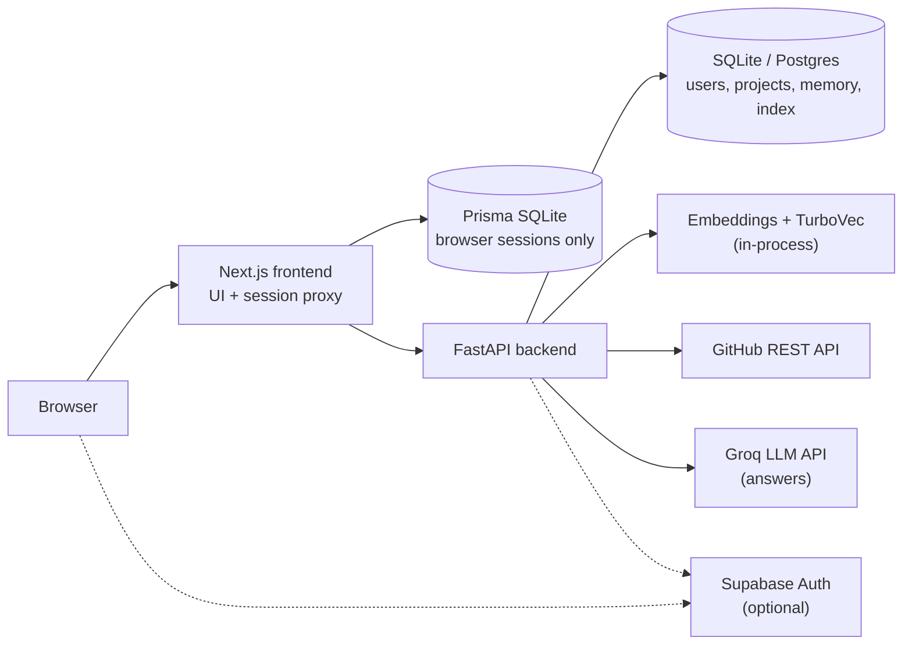
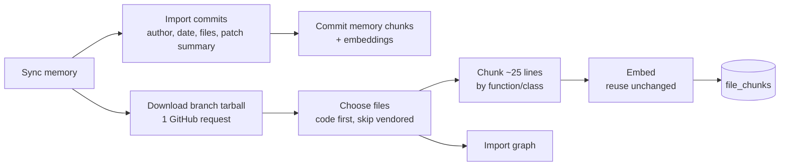
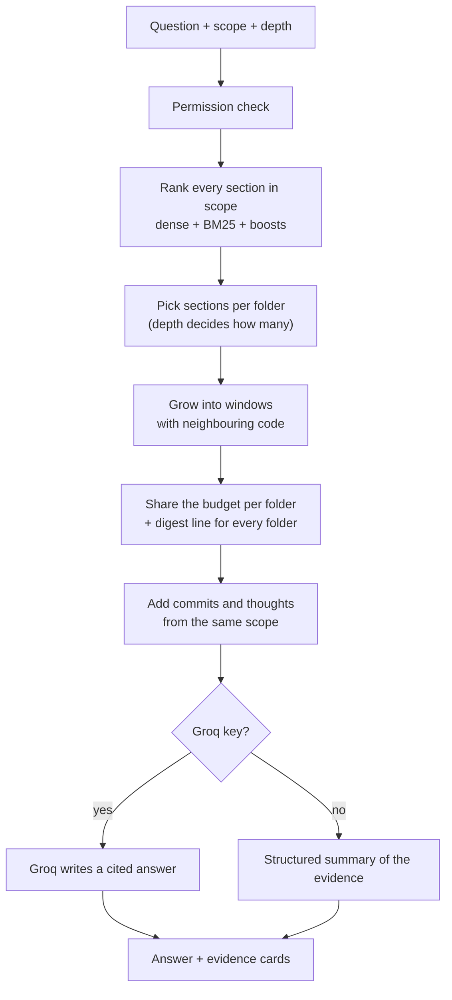
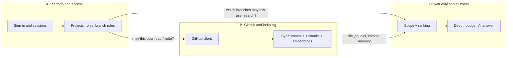

# DevHive: project guide

DevHive is a team workspace for GitHub repositories with an **engineering memory**. A team creates a project, links GitHub repositories, and controls who may do what through roles and branch rules. DevHive imports each branch's commit history and indexes its code. Anyone on the team can then ask questions in plain English, such as "what does each chapter do?", "where is bundle adjustment implemented?" or "who changed the face detector and why?". The answer is written by an AI model from the indexed code and history, and every claim is linked to the exact file, line range and commit it came from.

This guide explains the whole system: what each file does and how the main workflows run. Part 2 then splits the current state of the project between three team members, **A**, **B** and **C**, so each can present the part they own.

Contents
- [Part 1: The project](#part-1-the-project)
  - [1. What it does](#1-what-it-does)
  - [2. Architecture](#2-architecture)
  - [3. Repository layout](#3-repository-layout)
  - [4. Backend files](#4-backend-files)
  - [5. Frontend files](#5-frontend-files)
  - [6. Data model](#6-data-model)
  - [7. Workflows](#7-workflows)
  - [8. Running, configuring and testing](#8-running-configuring-and-testing)
  - [9. Current status](#9-current-status)
- [Part 2: Who did what](#part-2-who-did-what)
  - [A: Platform, accounts and access control](#a-platform-accounts-and-access-control)
  - [B: GitHub integration and the indexing pipeline](#b-github-integration-and-the-indexing-pipeline)
  - [C: Retrieval, AI answers and the Ask view](#c-retrieval-ai-answers-and-the-ask-view)
  - [How the three parts fit together](#how-the-three-parts-fit-together)
  - [Suggested presentation order](#suggested-presentation-order)

---

# Part 1: The project

## 1. What it does

| Area | What a user can do |
|---|---|
| Accounts | Register and sign in with email and password, or with GitHub or Google through Supabase. Reset a forgotten password. |
| Projects and people | Create a project, invite members, give them roles, and set branch rules that control who may push to or merge into which branches. |
| Repositories | Link their own GitHub repositories, or any public repository by URL (view only). Create a repository on GitHub from DevHive. |
| Browsing | Pick a branch, browse the file tree, read code with syntax colouring, and see commits, contributors and recent GitHub activity. |
| Git workflow | Create branches, open pull requests and merge them through DevHive, subject to the role and branch rules. |
| Memory | **Sync memory** imports a branch's commits and indexes its code. Team members add *thoughts* to files and *TCC records* (Thought, Change summary, Comment) to commits. |
| Ask | Ask questions about the code and its history. Choose **where** to look (any folders or files) and **how deep** to go (Low, Medium, High or Very high). Answers cite the exact code, lines and commits. |

The test repository used throughout development is `https://github.com/MasteringOpenCV/code` (branch `master`): 9 C++/Objective-C chapters, 156 indexed files, 1,293 code sections, 29 commits.

## 2. Architecture



- **The browser never talks to FastAPI directly.** Every call goes to the Next.js route `/api/backend/...`, which looks up the user's session and forwards the request with the FastAPI token attached. The token never reaches the browser.
- **FastAPI owns everything durable:** users, projects, roles, linked repositories, imported commits, the code index, embeddings, notes and the audit log.
- **GitHub remains the source of truth for code.** DevHive keeps only bounded copies: indexed text for searching, and commit metadata with short patch summaries.
- **The AI model only explains.** It receives a bounded, secret-filtered selection of evidence the user is already allowed to see. It has no tools and no GitHub access.

## 3. Repository layout

```
Rag orchestrator/
├─ DevHiveMain/
│  ├─ PROJECT_GUIDE.md        ← this file
│  ├─ backend/                FastAPI service (Python)
│  │  ├─ app/                 application code (see section 4)
│  │  │  └─ routes/           HTTP endpoints
│  │  ├─ tests/               110 unit and integration tests (unittest)
│  │  ├─ scripts/             evaluation and maintenance scripts
│  │  ├─ migrations/          optional Supabase pgvector SQL
│  │  ├─ ARCHITECTURE.md      design notes, permission rules, retrieval design
│  │  └─ README.md            setup and configuration
│  └─ frontend/               Next.js 15 / React 19 app (TypeScript)
│     ├─ app/                 pages, API routes (session, GitHub OAuth, proxy), CSS
│     ├─ components/          UI components (see section 5)
│     ├─ lib/                 client and server helpers
│     └─ prisma/              browser-session database schema
├─ PHASES.md                  the original three-phase plan
└─ *.docx                     project description, timeline and phase plan documents
```

## 4. Backend files

All paths are under `DevHiveMain/backend/app/`.

### Foundation

| File | Job |
|---|---|
| `main.py` | Builds the FastAPI app: creates the tables, adds any missing columns, mounts the routers, starts the weekly-sync thread and pre-loads the embedding model. |
| `config.py` | Reads settings from `backend/.env` (`DEVHIVE_*`, `SUPABASE_*`) into a `Settings` object. |
| `database.py` | SQLAlchemy engine and session factory. |
| `models.py` | All 24 database tables (see section 6). |
| `schemas.py` | Pydantic request bodies, for example `ChatIn` with `message`, `branch`, `scope` and `depth`. |
| `deps.py` | FastAPI dependencies: database session, settings and the current user. |
| `security.py` | Password hashing, session tokens, Fernet encryption for stored GitHub tokens and Groq keys. |
| `supabase_auth.py` | Verifies Supabase access tokens and links a verified identity to the DevHive account with the same email. |
| `permissions.py` | Permission bits, default roles, the branch-rule resolution (`effective_bits`), membership checks and audit logging. |

### GitHub and ingestion

| File | Job |
|---|---|
| `github.py` | GitHub REST client: repositories, branches, commits, file tree, tarball archive, file contents, events, branch creation and pull requests. All calls are bounded and use fixed GitHub URLs. |
| `syncing.py` | `sync_branch`: imports commit history (in parallel), stores commit memory, then calls the indexer. |
| `indexing.py` | Downloads the branch head as one tarball, chooses which files to index (code first, vendored folders skipped), chunks them, embeds them (reusing unchanged embeddings) and records the snapshot. |
| `chunking.py` | Splits source files into about 25-line chunks along function and class boundaries. Each chunk records its exact line range and the nearest symbol name. |
| `file_graph.py` | Parses `#include`, `#import`, Python and JavaScript imports into file-to-file links ("includes" / "used by"). |
| `scheduler.py` | Refreshes memory automatically every Sunday at 02:00 India time. A database lease stops two workers from running it twice. |

### Retrieval and answers

| File | Job |
|---|---|
| `rag.py` | Embeddings (sentence-transformers MiniLM, 384 dimensions), BM25 keyword scoring with an identifier-aware tokenizer, and `hybrid_rank` (dense plus BM25 fused by reciprocal-rank fusion, with symbol and filename boosts). Also the commit and thought search. |
| `scope.py` | Folder/file scope: validation, the SQL filter (LIKE wildcards escaped) and grouping files into folders. |
| `retrieval.py` | **Depth profiles** and the retrieval pipeline. It picks sections per folder, grows them into windows, writes the per-folder digests and shares the evidence budget between folders. |
| `llm.py` | Builds the labelled evidence (`[S1]`, `[S2]`...), calls Groq within a shared token budget, validates citations, handles cut-off answers, makes sure overview answers cover every folder, and runs the Very high map-reduce. |
| `chat_jobs.py` | In-memory background jobs for Very high questions: submit, poll progress, cancel. |

### HTTP endpoints (`app/routes/`)

| File | Endpoints |
|---|---|
| `auth.py` | `/auth/register`, `/login`, `/logout`, `/me`, `/password/reset`, `/supabase`, `/supabase/link`, `/github` (store or remove the GitHub token), `/github/repositories`, `/llm` (personal Groq key) |
| `projects.py` | `/projects` (create, list), `/members`, `/invitations`, `/roles`, `/branch-overrides`, `/audit`, `/permissions`, and linking repositories (`/repositories`, `/repositories/from-url`, `/repositories/new`) |
| `repositories.py` | `/repositories/{id}`: `branches`, `tree`, `scope-tree`, `file`, `commits`, `history`, `contributors`, `activity`, `access`, `pulls` (open and merge), `sync`, `sync-schedule`, `audit` |
| `memory.py` | `/repositories/{id}/chat`, `/chat/jobs` (Very high), `/search`, `/file-review` (and notes), `/file-chat`, `/tcc` |

Interactive API documentation is served at `http://127.0.0.1:8000/docs` while the backend runs.

### Scripts and tests

| Path | Job |
|---|---|
| `scripts/eval_repo.py` | End-to-end check against MasteringOpenCV/code on a throwaway database. It runs pointed, overview and scoped questions at every depth. Options: `--depth`, `--resync`, `--skip-sync`. |
| `scripts/sync_existing.py` | Re-syncs every branch that already has memory. |
| `scripts/check_semantic.py` | Confirms the embedding model loads. |
| `tests/` | `test_flow.py` (API, authorization, workflows), `test_insights.py` (indexing, chat, scope, depth, Very high jobs, LLM handling), `test_retrieval.py` (tokenizer, scope SQL, per-folder selection, budgeting), `test_chunking.py`, `test_indexing_selection.py`, `test_file_graph.py`, `test_scheduler.py`, `test_supabase_auth.py`. They use a fake GitHub client and a mocked Groq API. |

## 5. Frontend files

All paths are under `DevHiveMain/frontend/`.

| File | Job |
|---|---|
| `app/page.tsx` | Entry page: checks the session, loads the user and renders the workspace. |
| `app/login/page.tsx`, `app/auth/*` | Sign-in and register, Supabase OAuth callback, forgot and reset password. |
| `app/api/session/*` | Server routes for login, register, logout, Supabase sign-in and password reset. They create or clear the encrypted browser session. |
| `app/api/github/authorize`, `callback` | GitHub OAuth with PKCE. The resulting token is sent to FastAPI, which stores it encrypted. |
| `app/api/backend/[...path]/route.ts` | **The proxy.** It forwards every UI call to FastAPI with the session's token, blocks cross-origin writes and limits body size. |
| `lib/session.ts`, `lib/prisma.ts`, `prisma/schema.prisma` | Browser sessions: a random HTTP-only cookie, stored hashed, mapped to the encrypted FastAPI token. |
| `lib/api.ts`, `lib/backend.ts` | Fetch helper for UI calls; backend URL and origin checks. |
| `components/Workspace.tsx` | The app shell: sidebar of projects, tabs (Repositories, Activity, Memory, Settings), repository workspace, people, roles and branch rules. |
| `components/FileReview.tsx`, `CodeView.tsx`, `TreeIcons.tsx` | The repository explorer: file tree, read-only code viewer, per-file review (imports, changes, thoughts) and file questions. |
| `components/GitHubActivity.tsx` | Contributors, recent GitHub events and commits, with filters. |
| `components/GroqSettings.tsx` | Add or remove a personal Groq API key. |
| `components/MemoryWorkspace.tsx` | **The Ask view**: three resizable panes (scope tree, conversation, retrieved knowledge), the depth selector, scope chips and Very high progress. |
| `components/ScopeTree.tsx` | Click-to-select folder/file tree with partial-selection checkboxes, a filter box and green markers on files used in the last answer. |
| `components/KnowledgePane.tsx` | Evidence beside the answer: folder coverage, per-folder summaries, code cards with line ranges and history, commits and thoughts. Citation chips jump here. |
| `components/AnswerMarkdown.tsx` | Renders answers as Markdown and turns `[S1]` into clickable chips. |
| `lib/scope.ts`, `lib/depth.ts`, `lib/panes.ts` | Scope selection logic, the depth level descriptions, resizable panes. |
| `app/globals.css`, `insight.css`, `ask.css` | Design tokens and layout, code and evidence styling, the Ask view. |

## 6. Data model

| Group | Tables | Notes |
|---|---|---|
| Identity | `users`, `session_tokens`, `external_identities`, `github_profiles`, `user_llm_credentials`, `password_reset_uses` | GitHub tokens and Groq keys are stored encrypted. |
| Projects and access | `projects`, `memberships`, `roles`, `invitations`, `branch_overrides`, `audit_events` | Roles hold permission bits; branch overrides adjust write bits per branch pattern. |
| Repositories | `repositories`, `read_only_repositories` | URL-linked repositories are marked view only. |
| History memory | `commit_records`, `tcc_records`, `memory_chunks` | One searchable chunk per commit and per TCC record, with its embedding. |
| Code index | `file_chunks`, `file_dependencies`, `branch_snapshots`, `branch_graph_states`, `branch_embedding_states` | One row per code section (path, line range, symbol, text, embedding), plus the import graph and the index version per branch. |
| Collaboration | `file_review_notes` | Thoughts attached to files. |
| Scheduling | `weekly_sync_runs` | Lease and results of the Sunday refresh. |

**Permission bits:**
- `view_project`, `view_repository`, `view_memory`, `sync_repository` (every project member);
- `create_repository`, `create_branch`, `push`, `merge`, `write_tcc`, `view_audit` (granted by role).

**Default roles:**
- *Contributor*: push, write TCC, create branches.
- *Maintainer*: Contributor's rights plus create repository, merge and view audit.
- The project owner holds every right and is the only person who can change roles and rules.

## 7. Workflows

### 7.1 Sign in
1. The user submits the login form. Next.js `/api/session/login` calls FastAPI `/auth/login`, which checks the password and returns a session token.
2. Next.js stores the token encrypted in its Prisma session table and sets an HTTP-only cookie.
3. Every later UI call goes through `/api/backend/...`, which adds `Authorization: Bearer <token>`. FastAPI resolves the user in `deps.current_user`.
4. *Optional:* the user signs in with GitHub or Google through Supabase. FastAPI verifies the Supabase token and links it to the account with the same verified email.

### 7.2 Set up a project
1. Create a project. The creator becomes its immutable owner, and the default roles and branch rules are created.
2. Add members or send invitations. An invitation becomes a membership when the person signs in with the invited email.
3. Adjust roles and branch rules. The most specific matching branch rule wins, and a rule on `feature/work` also covers `feature/work/child`.
4. Every membership change is recorded in the audit log.

### 7.3 Link a repository
- **Own repository:** connect GitHub through OAuth, then pick one of the repositories you can push to.
- **Anyone's public repository:** paste its URL. It is linked view only, and branch, pull request and TCC writes are refused.
- **New repository:** create it on GitHub from DevHive.

### 7.4 Sync memory (ingestion)

- Triggered by **Sync memory**, or automatically every Sunday.
- If the branch head hasn't changed, nothing is rebuilt.
- If the chunking or embedding model changes, the index version (`semantic-v5`) changes and the next sync rebuilds automatically.
- When GitHub is unreachable, the branch list, file tree and file previews fall back to the last synced snapshot.

### 7.5 Ask a question


**The rule that drives the design:**
- **Scope decides where knowledge comes from:** the selected folders and files and everything under them, or the whole repository when nothing is selected.
- **Depth decides only the quality:** how many sections per folder, how much code around each, how much history, and how long the answer is.
- **Every depth covers every folder in scope.**

| Depth | Sections per folder | Code sent per folder (10 folders) | Answer | Time (free Groq tier) |
|---|---|---|---|---|
| Low | 1 | ~180 characters | 1–2 sentences per folder | seconds |
| Medium | up to 2 | ~420 characters | short paragraph per folder | seconds |
| High | up to 3 | ~500 characters, with history | detailed section per folder | up to ~1 min |
| Very high | up to 5 | ~1,000 characters | section per folder plus synthesis, 4–5 AI calls | ~2–3 min |

Overview questions give every folder code. Pointed questions give code to the folders that match, and the others appear as one-line summaries. If an AI answer skips a folder in an overview, the missing folder is appended from its summary.

**Very high** runs as a background job. The browser polls `/chat/jobs/{id}` every 1.5 s and shows progress such as "Summarising Chapter 3, Chapter 4 (2 of 4)". Each group of folders is summarised in its own AI call, then one final call writes the combined answer. The job can be cancelled.

### 7.6 Explore, review and record thoughts
- Browse the tree and open a file. The review panel shows its imports and dependents, the commits that changed it and the team's thoughts.
- Add a thought to a file. Only its author or the project owner can edit it.
- Record a TCC (Thought, Change summary, Comment) on an imported commit. It is permanent and becomes searchable memory.

### 7.7 Branches and pull requests
- Create a branch, open a pull request or merge one. DevHive checks the user's branch rights first, then acts with that user's own GitHub token.
- DevHive cannot stop someone pushing to GitHub directly. GitHub's own branch rules are needed for that.

## 8. Running, configuring and testing

**Backend** (PowerShell, from `DevHiveMain/backend`):
```powershell
python -m venv .venv
.\.venv\Scripts\python.exe -m pip install -r requirements-semantic.txt
.\.venv\Scripts\python.exe -m uvicorn app.main:app --host 127.0.0.1 --port 8000 --reload
```

**Frontend** (from `DevHiveMain/frontend`):
```powershell
npm.cmd install
npm.cmd run db:migrate
npm.cmd run dev        # http://127.0.0.1:3000
```

**Main settings:**

| Setting | Where | Purpose |
|---|---|---|
| `DEVHIVE_SECRET` | backend `.env` | Encryption key for tokens. Must be at least 32 characters. |
| `DEVHIVE_DATABASE_URL` | backend | SQLite file (default) or Postgres. |
| `DEVHIVE_EMBEDDING_MODEL` | backend | `sentence-transformers/all-MiniLM-L6-v2` for semantic search. |
| `DEVHIVE_RAG_BACKEND` | backend | `turbovec` (default) or `supabase`. |
| `DEVHIVE_GROQ_API_KEY`, `DEVHIVE_GROQ_MODEL`, `DEVHIVE_GROQ_TPM` | backend | Shared AI key, model (default `openai/gpt-oss-120b`), tokens-per-minute budget (default 7000). |
| `DEVHIVE_GITHUB_TOKEN` | backend | Read-only token for public repositories. Without it, GitHub allows only 60 requests per hour. |
| `DEVHIVE_MAX_INDEX_FILES` | backend | Files indexed per branch (default 400). |
| `DEVHIVE_WEEKLY_SYNC_ENABLED`, `DEVHIVE_WEEKLY_SYNC_HOUR` | backend | Sunday refresh. |
| `SUPABASE_URL`, `SUPABASE_PUBLISHABLE_KEY`, `SUPABASE_SECRET_KEY`, `DEVHIVE_SITE_URL` | backend | Optional Supabase sign-in, invitations, password reset. |
| `NEXT_SESSION_SECRET`, `BACKEND_URL`, `DATABASE_URL` | frontend `.env` | Session encryption, FastAPI address, Prisma database. |
| `GITHUB_CLIENT_ID`, `GITHUB_CLIENT_SECRET`, `GITHUB_OAUTH_REDIRECT_URL` | frontend | GitHub OAuth app. |
| `NEXT_PUBLIC_SUPABASE_URL`, `NEXT_PUBLIC_SUPABASE_PUBLISHABLE_KEY` | frontend | Optional Supabase sign-in. |

**Tests and checks:**
```powershell
# backend: 110 tests
.\.venv\Scripts\python.exe -m unittest discover -s tests -v
# retrieval check against the real test repository, without using AI tokens
$env:DEVHIVE_GROQ_API_KEY=""; .\.venv\Scripts\python.exe scripts\eval_repo.py --depth low,medium,high,very_high
# frontend
npx tsc --noEmit; npm.cmd run build
```

## 9. Current status

Status against the original three-phase plan (`PHASES.md`):

| Phase | Plan | Status |
|---|---|---|
| 1. Foundation | Accounts, projects, roles, GitHub import, TCC, keyword memory | **Done.** Supabase sign-in, invitations, password recovery and the audit log were added on top. |
| 2. Managed Git workflow | Branch creation, pull requests, merge and push gating through DevHive | **Mostly done.** Branch, pull request and merge actions are gated by roles and branch rules. Editing files through DevHive was removed on purpose, and pushes made directly on GitHub need GitHub's own rules. |
| 3. Semantic RAG | Semantic embeddings, versioned chunking, cited AI answers, retrieval evaluation, dashboard, background workers | **Mostly done, with simpler tools than planned.** It uses MiniLM embeddings with SQLite and an in-process index rather than Qdrant and BGE-M3, plus a versioned index, cited Groq answers, scope and depth control, and an evaluation script. **Not started:** the dashboard, webhook-driven sync and separate background workers. |

**Verified recently:**
- 110 backend tests pass, and the frontend typechecks and builds.
- The evaluation reports 0 failures at every depth. Overview questions get code from all 10 folders at every depth, and pointed and scoped questions find the expected files.
- In live AI runs, "What does each chapter do?" named all 9 chapters at Low, Medium, High and Very high.

**Known limits:**
- **Free AI tier is slow.** The free Groq tier allows 8,000 tokens per minute, so High can wait up to a minute and Very high takes about 2–3 minutes. A paid plan removes most of the wait.
- **Single process.** Very high jobs, the AI token budget and the search caches live in one backend process. Running several servers would need them moved to the database or Redis.
- **No catch-up for missed refreshes.** The Sunday refresh needs the backend running on Sunday, and a missed run is not repeated on Monday.
- **Explorer questions are narrower.** The explorer's own "ask about this file" box still answers from that one file and its linked files. Wider questions belong in the Ask view.
- **Some README details are outdated.** Some sentences in the backend and frontend READMEs predate the latest retrieval changes (chunk size, evidence limits, the Memory tab). `backend/ARCHITECTURE.md` is current.

---

# Part 2: Who did what

The current project splits naturally into three areas, one per person. Each section below lists what that person built, which files they own, how to explain it, what is finished and what is left. The split follows the code: each person owns separate files, and the three parts meet at clear boundaries (section [How the three parts fit together](#how-the-three-parts-fit-together)).

| | A | B | C |
|---|---|---|---|
| Area | Platform, accounts and access control | GitHub integration and the indexing pipeline | Retrieval, AI answers and the Ask view |
| One-line pitch | "Who you are and what you may do." | "Getting the code and history in, and keeping it fresh." | "Turning a question into a cited, complete answer." |
| Main backend files | `main.py`, `config.py`, `database.py`, `models.py`, `security.py`, `deps.py`, `supabase_auth.py`, `permissions.py`, `routes/auth.py`, `routes/projects.py` | `github.py`, `syncing.py`, `indexing.py`, `chunking.py`, `file_graph.py`, `scheduler.py`, `routes/repositories.py`, file review and TCC in `routes/memory.py` | `rag.py`, `scope.py`, `retrieval.py`, `llm.py`, `chat_jobs.py`, chat endpoints in `routes/memory.py`, `scripts/eval_repo.py` |
| Main frontend files | `app/api/session/*`, `app/api/github/*`, `app/api/backend/[...path]`, `lib/session.ts`, `lib/backend.ts`, login and auth pages, Settings and People sections of `Workspace.tsx`, `GroqSettings.tsx` | Repositories tab of `Workspace.tsx`, `FileReview.tsx`, `CodeView.tsx`, `TreeIcons.tsx`, `GitHubActivity.tsx` | `MemoryWorkspace.tsx`, `ScopeTree.tsx`, `KnowledgePane.tsx`, `AnswerMarkdown.tsx`, `lib/scope.ts`, `lib/depth.ts`, `lib/panes.ts`, `ask.css` |
| Main tests | `test_flow.py` (authorization, roles, invitations, keys), `test_supabase_auth.py` | `test_chunking.py`, `test_indexing_selection.py`, `test_file_graph.py`, `test_scheduler.py`, indexing tests in `test_insights.py` | `test_retrieval.py`, chat, scope, depth and job tests in `test_insights.py` |

## A: Platform, accounts and access control

**Responsibility:** the application foundation, sign-in, sessions, projects, people, roles, branch rules, encryption and the audit trail. Everything else relies on A's checks.

**What A built**
1. **Application skeleton.**
   - The FastAPI app factory (`main.py`), settings from `.env` (`config.py`) and database sessions (`database.py`).
   - The full data model of 24 tables (`models.py`).
   - Start-up creates missing tables and columns.
2. **Accounts and sign-in** (`routes/auth.py`, `security.py`).
   - Registration and login with hashed passwords, account lockout after repeated failures, and expiring session tokens.
   - Optional Supabase sign-in with GitHub or Google (`supabase_auth.py`): a verified email links to the existing DevHive account and keeps its projects.
   - Password reset through a Supabase recovery link. A reset ends all existing sessions, and a reset token cannot be reused.
3. **Browser sessions in Next.js** (`lib/session.ts`, `prisma/schema.prisma`, `app/api/session/*`).
   - The browser holds only a random HTTP-only cookie; Next.js stores its hash and the encrypted FastAPI token.
   - The proxy (`app/api/backend/[...path]/route.ts`) adds the token to every call, rejects cross-origin writes and limits body size.
4. **GitHub account connection** (`app/api/github/authorize`, `callback`, `/auth/github`). OAuth with PKCE and a state check; the token is stored encrypted on the backend and never returned.
5. **Projects, people and permissions** (`routes/projects.py`, `permissions.py`).
   - Projects with an immutable owner, members and email invitations.
   - Roles built from permission bits, plus branch rules where the most specific pattern wins and parent rules cover nested branches.
   - Outsiders get "not found" instead of "forbidden", so the existence of private projects isn't revealed.
   - Every sensitive action is written to the audit log.
6. **AI key management** (`/auth/llm`, `GroqSettings.tsx`).
   - A shared workspace key with per-user rate limits, plus optional personal keys, encrypted per user.
   - Keys are never shown again and never used for another user.
7. **Workspace UI shell** (`Workspace.tsx`): sidebar, project tabs, the Settings screens for connections, people and roles, and the resizable sidebar.

**How to explain it:** walk through "a new teammate joins".
1. They receive an invitation and sign in.
2. They see every repository in the project.
3. Their role decides whether they can create branches or merge into `main`, and a branch rule can tighten that for one branch.
4. Show that an outsider gets "not found" for the same URLs.

**Status**
- Done: all of the above, covered by `test_flow.py` and `test_supabase_auth.py`.
- Left to do:
  - Database migrations instead of create-on-start (needed for production Postgres).
  - Production email delivery settings for Supabase invitations.
  - A shared session and rate-limit store if more than one backend server is run.

## B: GitHub integration and the indexing pipeline

**Responsibility:** everything that talks to GitHub, and the pipeline that turns a branch into searchable memory. B also owns the repository explorer, activity views and review notes.

**What B built**
1. **GitHub client** (`github.py`).
   - Bounded reads of repositories, branches, commits, trees, file contents and events.
   - The branch tarball as a single request.
   - Branch creation, pull requests and merges using each user's own token.
2. **Repository linking and browsing** (`routes/repositories.py`).
   - Linking owned repositories, linking public ones by URL (view only) and creating new ones.
   - Branch list, file tree (up to 5,000 files, each marked as indexed or not) and file preview.
   - Commits, history, contributors and GitHub activity.
   - Pull requests, with each write checked against A's branch rights.
   - When GitHub is down or rate limited, branches, the tree and file previews fall back to the last synced snapshot.
3. **Sync pipeline** (`syncing.py`, `indexing.py`).
   - Imports up to 500 commits in parallel, with changed files and patch summaries, and stores them as searchable commit memory.
   - Downloads the branch head as one tarball and chooses files: code first, then docs, then tests, skipping vendored folders and secrets.
   - Embeds new or changed chunks only, reusing stored embeddings for unchanged code.
   - Records a snapshot, so an unchanged branch isn't rebuilt.
4. **Chunking** (`chunking.py`).
   - About 25-line sections that start at function or class definitions.
   - Each section keeps its exact line range and symbol name, so answers can cite `file.cpp:L46-79`.
   - Changing the chunking bumps the index version, which triggers a rebuild on the next sync.
5. **Import graph** (`file_graph.py`).
   - C/C++ `#include`, Objective-C `#import`, Python and JavaScript imports become "includes" and "used by" links.
   - Used by the file review panel and to add related files to single-file questions.
6. **Automatic refresh** (`scheduler.py`). Every Sunday at 02:00 India time it re-syncs default branches and previously synced branches, with a database lease against duplicate runs.
7. **Explorer and collaboration UI** (`FileReview.tsx`, `CodeView.tsx`, `GitHubActivity.tsx`, Repositories tab).
   - File tree, syntax-coloured read-only code with highlighted lines, and the per-file review panel.
   - Thoughts on files, TCC records on commits, and contributor and activity views.

**How to explain it:** run **Sync memory** on MasteringOpenCV/code and narrate the result: "29 commits imported; 156 files, 1,293 sections searchable". Then:
1. Open `cartoon.cpp` and show its sections, imports and the commits that touched it.
2. Re-run sync to show that nothing is rebuilt when the branch hasn't changed.
3. Mention the snapshot fallback when GitHub is rate limited.

**Status**
- Done: all of the above, covered by the chunking, indexing, file graph and scheduler tests and the sync parts of `test_insights.py`.
- Left to do:
  - Webhook-driven sync, so memory updates on every push rather than weekly or manually.
  - A catch-up run when the Sunday refresh is missed.
  - Choosing files evenly across folders for very large repositories: the 400-file cap currently fills in path order.
  - Updating the explorer's per-file question box to use the new retrieval.

## C: Retrieval, AI answers and the Ask view

**Responsibility:** turning a question into an answer. That covers ranking, scope, depth, evidence budgeting, the AI call, citation checking and the Ask screen where people use it.

**What C built**
1. **Hybrid search** (`rag.py`).
   - Semantic embeddings (MiniLM) plus BM25 keyword scoring with a code-aware tokenizer. The tokenizer splits camelCase and snake_case and links word forms such as `train`/`trained` and `detect`/`MarkerDetector`.
   - The two rankings are fused, with boosts for exact symbol and file names and penalties for comment-only code.
   - Results are deterministic, and common question words no longer leak into the search.
2. **Scope** (`scope.py`, `ScopeTree.tsx`, `lib/scope.ts`).
   - Any mix of folders and files can be selected. Selecting a folder includes everything under it, and partly selected folders show a partial checkbox.
   - Selected rows are highlighted, and files used in the last answer get a green marker.
   - The scope is enforced in SQL for both code and commit history.
3. **Depth and evidence** (`retrieval.py`).
   - Four depth levels that change only the quality, never which folders are covered.
   - Each folder gets its best sections, grown into windows with surrounding code ("small-to-big").
   - Every folder gets a summary line, near-duplicate files are merged, and the budget is shared fairly between folders.
   - Budgets are sized to the AI provider's per-minute limit.
4. **AI answers** (`llm.py`).
   - Labelled evidence (`[S1]`, `[S2]`...) under a shared token budget. Answers whose citations don't exist are rejected.
   - A folder-by-folder answer format with a word budget per folder; cut-off answers are tidied.
   - A coverage guard makes overview answers name every folder.
   - Secret filtering keeps credentials away from the provider.
   - Very high splits the work into per-folder summaries and a final synthesis.
5. **Background jobs** (`chat_jobs.py`, `/chat/jobs`). Very high runs in the background with progress updates and cancel. Only the person who started a job can see it.
6. **The Ask view** (`MemoryWorkspace.tsx`, `KnowledgePane.tsx`, `AnswerMarkdown.tsx`, `ask.css`).
   - Three resizable panes, a Low / Medium / High / Very high selector with plain-language descriptions, scope chips, and a progress bar with Cancel.
   - A **Folder coverage** card shows every folder as "code excerpts" or "summary only".
   - Evidence cards are grouped by folder, and citation chips jump to their card.
   - The view stays mounted when switching tabs, so a conversation or a running Very high question isn't lost.
   - The layout adapts to tablet and phone widths.
7. **Evaluation** (`scripts/eval_repo.py`).
   - Repeatable checks on the real test repository: pointed questions must find the right file, overview questions must reach all 10 folders at every depth, and scoped questions must stay inside the scope.

**How to explain it:**
1. Ask "What does each chapter of this repository do?" at Low, then at High, and show that both cover all 9 chapters while High is much more detailed.
2. Select only `Chapter5_NumberPlateRecognition`, ask "How is the OCR trained?", and show that every source comes from that folder.
3. Click a `[S2]` chip to jump to the exact code and lines.
4. Explain the original problem and its fix. Answers used to cover only Chapter 1, because questions were pinned to one file, only about 2.5 files of evidence survived, there was no folder diversity, and ties favoured Chapter 1. Ranking the whole scope, then picking per folder and budgeting per folder, fixed it.

**Status**
- Done: all of the above, covered by `test_retrieval.py`, the chat, scope, depth and job tests in `test_insights.py`, the evaluation script and live runs at every depth.
- Left to do:
  - Cache per-folder summaries per synced commit, so Very high needs fewer AI calls.
  - A re-ranking model for paraphrased questions.
  - Save chat history and support follow-up questions.
  - Move the job store and token budget out of process memory before scaling to several servers.

## How the three parts fit together



- **A → B:** every GitHub write (branch, pull request, merge) and every sync first passes A's permission checks (`require_permission`, `effective_bits`).
- **B → C:** C reads only what B stored: `file_chunks` (path, line range, symbol, text, embedding), commit and TCC memory, and the import graph. If B changes the chunking, the index version changes and C ignores stale branches until they are re-synced.
- **A → C:** every question re-checks project membership and branch access before any ranking, so permission changes take effect immediately, without re-indexing.
- **Shared contract:** the `/chat` response, which holds the answer, cited files with line ranges, commits, folder coverage and retrieval statistics. C renders it in the UI; A's proxy carries it.

## Suggested presentation order

1. **A** (5 min): what DevHive is, the architecture diagram, sign-in, creating a project and the permission model.
2. **B** (5 min): linking MasteringOpenCV/code, Sync memory and what gets stored, then the explorer and file review.
3. **C** (7 min): the Ask view, scope selection, the four depth levels on the same question, citations, Very high progress, and the "Chapter 1 only" story with its fix.
4. **All** (3 min): current status against the three-phase plan, known limits, and next steps.
