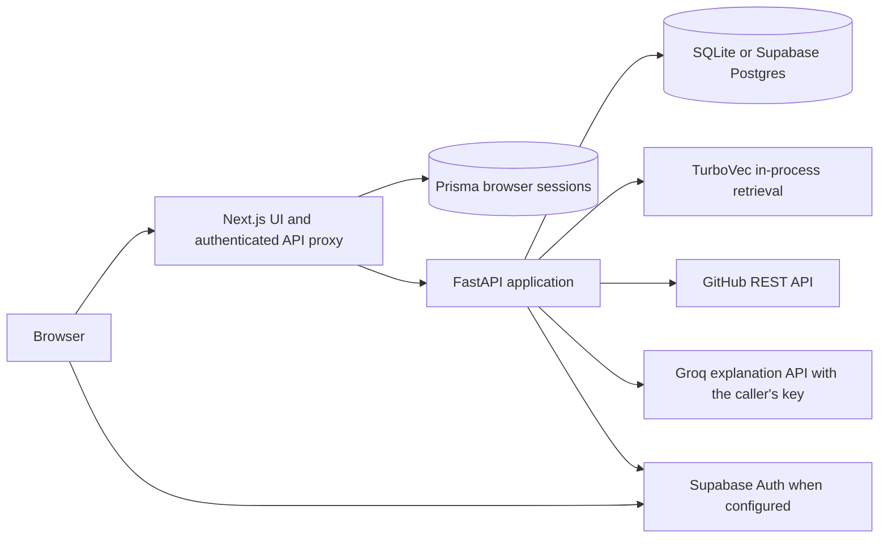

# DevHive architecture

The Next.js proxy keeps the FastAPI bearer token off the browser. Prisma stores browser sessions only. FastAPI owns users, project membership, permissions, repositories, GitHub imports, memory, and audit records. Repository source content remains on GitHub; DevHive keeps bounded indexed text and commit context in its own SQL database. TurboVec is an accelerator rebuilt from those durable rows as needed. For Supabase Postgres, DevHive uses a private `devhive` schema.

## Module map

| Path | Job |
| --- | --- |
| `app/main.py`, `app/config.py`, `app/database.py` | Application bootstrap, settings, database sessions. |
| `app/models.py` | SQL tables for identities, projects, roles, linked repositories, commit records, file chunks, import links, review notes, TCC, and audit. |
| `app/security.py`, `app/deps.py`, `app/supabase_auth.py` | Password and session security, encrypted GitHub tokens, verified Supabase identity and invitations. |
| `app/permissions.py` | Project membership and owner control, role bits, slash-nested branch write overrides, audit logging. |
| `app/github.py` | Bounded GitHub reads, branch creation, and pull request actions. |
| `app/indexing.py`, `app/file_graph.py` | Branch-head file snapshot indexing and local import resolution. |
| `app/syncing.py`, `app/scheduler.py` | Shared ingestion and Sunday automatic refresh with a database lease. |
| `app/rag.py` | 384-dimensional embeddings, TurboVec filtering, retrieval and cited extractive answers. |
| `app/llm.py` | Optional personal Groq explanation over bounded, permission-checked evidence. |
| `app/routes/projects.py`, `app/routes/repositories.py`, `app/routes/memory.py` | Project administration, GitHub workflows, chat and TCC endpoints. |
| `tests/` | Workflow, authorization, invitation and retrieval tests with a fake GitHub client. |

## Authorization

Project membership grants read access to every linked repository, branch, history entry and memory record. Outsiders receive 404 for project and repository resources. Only the immutable project owner may change roles, memberships, invitations and branch rules. A role grants actions including `create_repository`, `create_branch`, `push`, `merge`, `write_tcc` and `view_audit`. Every member can sync memory; sync is a read/index action. The most specific matching branch override controls write bits. A literal branch path also covers slash-nested children until a more specific rule overrides it. Per-repository grants are no longer part of authorization.

Creating a branch, opening a pull request, and merging through DevHive check the relevant source or target branch bits and use the acting developer's encrypted GitHub OAuth token. DevHive's file browser is read only; the file write API has been removed. Review notes are separate DevHive records: project members may add thoughts, while the note author or project owner may revise one. DevHive cannot stop a person from pushing through `git` or GitHub's own UI. The repository owner must configure GitHub branch rulesets and GitHub write access for enforcement outside DevHive.

Repositories added through a GitHub URL are marked in `read_only_repositories`. Public links may use anonymous GitHub reads when no connected account is available; private links require the linking account's existing GitHub read access. The URL is parsed as an identifier, never used as a network destination. DevHive enforces view-only behavior at every GitHub write endpoint and hides those actions in the UI. Project membership still gates visibility. Anonymous sync limits commits and files to preserve GitHub's lower unauthenticated rate limit.

## Memory pipeline

1. A member selects a branch and calls `POST /repositories/{id}/sync`. DevHive imports the commit history (up to 500 commits, details fetched in parallel) with author, date, changed files and a bounded patch summary, then downloads the branch head as one tarball and indexes up to `DEVHIVE_MAX_INDEX_FILES` text files (default 400, 200 KB each), skipping vendored folders. `app/chunking.py` splits files along function and class boundaries into chunks that record their exact line range and symbol. Embeddings are generated in batches, and unchanged chunks reuse their stored embedding. The response reports partial indexing only when the tree is truncated or a file was too large.
2. Commit and TCC records are immutable history; file chunks represent the latest synchronized head for each branch. Branch and commit SHA are stored on every citation. SQL persists embeddings and a per-branch embedding profile. When the configured model or indexing profile changes, the next sync re-embeds commit/TCC records and rebuilds code chunks even if the GitHub head is unchanged. Retrieval excludes branches with a stale profile.
3. At query time, membership is checked again. Chat with a branch selects that branch's records; search without one spans accessible, current-profile branches. Retrieval (`app/rag.py`) is hybrid: dense similarity and Okapi BM25 over identifier-aware tokens are fused with reciprocal-rank fusion, then exact symbol and file-name matches are boosted and comment-only chunks and bare headers are demoted. Permission filtering happens before ranking. Embeddings and token counts are cached per repository version; TurboVec is used for dense candidates only on very large corpora. Without an embedding model, BM25 plus a lexical hashing vector is used.
4. Chat always searches code and history together. It returns up to five code locations from the index (file, symbol, exact lines, GitHub link at the synced commit, commit history with authors and dates, merged contributors, thoughts, include/import links) plus a contributor summary for history questions, so a question makes no GitHub request. If a Groq key is available (a personal key, otherwise the workspace key `DEVHIVE_GROQ_API_KEY`), `app/llm.py` sends bounded, secret-filtered evidence under a shared per-minute token budget and returns a cited Markdown explanation; otherwise a structured extractive summary is returned. When GitHub is unreachable, the branch list, tree and file preview fall back to the last synced snapshot. File review uses a branch -> folder -> file scope: C/C++ `#include`, Objective-C `#import`, Python and JavaScript/TypeScript imports become directed file links, and file questions start with the selected file and its linked files.
5. Static import parsing is best effort and reverse links exist only for indexed source files. After GitHub changes, sync again to refresh the graph. Answers can still be mistaken, so the displayed code, line numbers and citations remain the verification source.

## Activity and limits

Personal Groq credentials are stored encrypted in a user-keyed table. Chat loads only the signed-in user's key after project and branch access checks. The provider destination is fixed HTTPS, receives bounded evidence and the question, and gets no write tools. Obvious secret paths and values are withheld from provider context, but this filter cannot recognize every possible secret in source code. Users choose whether to enable the external provider for their own account.

The activity panel combines GitHub's recent push, branch and pull request events with live commit history. The contributor summary groups the latest 100 branch commits by GitHub author; commit inspection shows changed files and bounded patches. GitHub's Events API can be delayed and does not provide a permanent activity archive. Existing imported commits remain searchable after later GitHub activity.

GitHub tokens are encrypted at rest and omitted from responses. FastAPI validates GitHub owner, branch and path inputs; file preview is capped at 100 KB. The Next.js proxy holds an HTTP-only browser session and blocks cross-origin mutations. Supabase Auth is optional; its secret key belongs only on the backend. The FastAPI process checks each minute for the Sunday 02:00 India-time refresh. It uses a database lease to avoid duplicate weekly runs across workers and refreshes each repository's default branch plus branches with prior snapshots. Manual sync remains available. The scheduler needs a running backend on Sunday; there is no catch-up on Monday and no webhook worker. A production multi-instance deployment needs database migrations and a shared retrieval/index plan; current SQL startup uses `create_all` and TurboVec is process-local.

## Scope, depth and retrieval windows

**The scope decides where knowledge comes from; the depth decides how much of it is read.** A question is answered from the folders and files selected in the Ask view's scope tree and everything under them, or from the whole repository when nothing is selected (`scope` on `POST /repositories/{id}/chat`). Every depth (`low`, `medium`, `high`, `very_high`) covers every folder in that scope; depth never changes which folders are read, only the quality: sections per folder, window size, code sent per folder, history detail and answer length (`DEPTH_PROFILES` in `app/retrieval.py`).

- **Folders.** A folder is the first level below the selection (`scope.group_key`): the top-level folders when nothing is selected, the subfolders of a selected folder, `(root)` for top-level files. Scope is applied in SQL (`app/scope.py`, LIKE wildcards escaped) to code chunks and, through the changed-file lists of imported commits, to history and thoughts.
- **Coverage.** Every folder gets a digest line (files, sections, key functions, the README's opening; `folder_digests`), always sent first, so no folder is ever cut off a prompt. Overview questions (`is_broad`: "each", "all", "chapters", "structure"..., several folders selected, or Very high) give every folder code excerpts, topping up folders that ranking missed with their README and the openings of further files. Pointed questions give code only to folders within 35% of the best match and keep the others as digest lines. If the model still skips a folder in an overview, `llm._ensure_coverage` appends it from its digest.
- **Small-to-big.** Chunks are small (about 25 lines, `app/chunking.py`) so they rank precisely. The whole scope is ranked (hybrid dense + BM25); each folder's best chunks become seeds (`select_per_folder`; at least `per_folder`, more when few folders take part), grown into windows with their neighbouring chunks (`expand_windows`). Near-identical copies of a file in different folders are collapsed.
- **Budget.** `budget_windows` shares the evidence budget between folders: each gets at least one minimal excerpt; the rest follows relevance strongly for pointed questions and mildly for overviews; inside a folder the share is split over as many sections as stay useful. `resolve_profile` clamps every budget to `DEVHIVE_GROQ_TPM`, and the depth's answer guidance carries a per-folder word budget sized to the output allowance (`_depth_note`), so long multi-folder answers are not cut off. On the 10 folders of MasteringOpenCV/code at 7000 TPM this is about 200 / 450 / 580 / 990 characters of code per folder at Low / Medium / High / Very high.
- **Very high** runs as a background job (`POST /repositories/{id}/chat/jobs`, polled with `GET`, cancelled with `DELETE`; `app/chat_jobs.py`, in memory, single process): evidence is grouped by folder, each group is summarised in its own model call, then one call writes the answer from the notes. Source labels stay global across calls so citations resolve. On the free Groq tier this takes about two minutes.
- `GET /repositories/{id}/scope-tree` lists the indexed files with section counts: exactly what a question can be scoped to. Each answer returns `retrieval` stats (`folders_in_scope`, `folders_covered`, `folders_with_code`, `avg_excerpt_chars`, ...) and the digests as `outline`.

Changing chunking or the embedding profile bumps `embedding_profile` (currently `semantic-v5`), so the next sync rebuilds the index. `scripts/eval_repo.py --depth low,medium,high,very_high` checks pointed, overview and scoped questions against MasteringOpenCV/code (`--skip-sync` reuses the eval index without calling GitHub).
